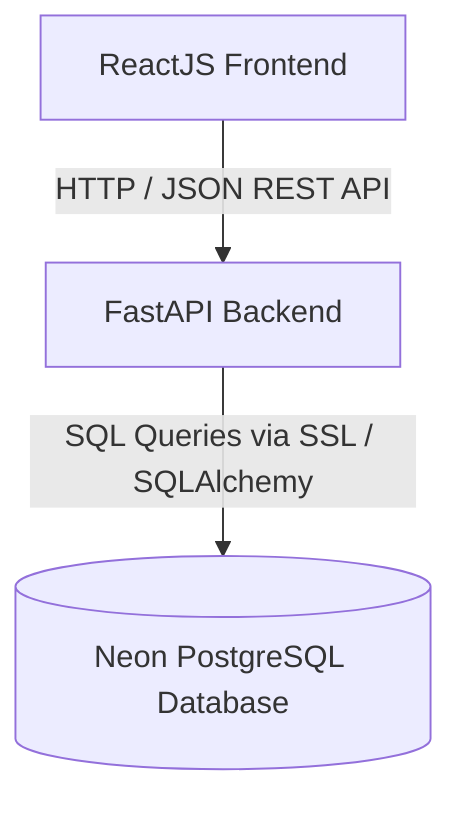

# Application Architecture

## 1. System Technology Flow

The application follows a clean, single 3-tier architecture:



* **Frontend**: ReactJS (Single-Page Application running in the user's browser).
* **Backend**: FastAPI with Python (one single backend service running REST APIs).
* **Database**: Neon PostgreSQL (cloud-hosted relational database).
* *Note: Node.js/Express is NOT used as an application backend.*

---

## 2. Complete User Flow

```
[Register / Login] ──> [View Products] ──> [Add to Cart] ──> [View Cart]
                              │
                              └──> [Add Product] (Admin action)
```

1. **Register / Login**: The customer signs up or logs in. A security token (JWT) is returned and stored in the browser.
2. **View Products**: The frontend requests the product catalog from the backend and renders it on screen.
3. **Add Product**: An admin submits product details. The backend validates and inserts the product into Neon PostgreSQL.
4. **Add to Cart**: The logged-in customer clicks "Add to Cart". The backend links the user's ID with the product ID.
5. **View Cart**: The customer opens their cart. The backend fetches all items saved for that user from Neon PostgreSQL.

---

## 3. Component Responsibility Matrix

| Feature / Responsibility | Where it is Handled | Description |
| :--- | :--- | :--- |
| **Authentication Logic** | **FastAPI Backend** | Hashes passwords securely, checks credentials, and issues JWT access tokens. |
| **Token Storage** | **ReactJS Frontend** | Stores JWT token in browser `localStorage` and includes it in request headers (`Authorization: Bearer <token>`). |
| **Product Logic** | **FastAPI Backend** | Validates product fields (title, price, image URL, description) before saving or returning catalog data. |
| **Cart Logic** | **FastAPI Backend** | Links product items to the logged-in user and calculates total cart price. |
| **Database Access** | **FastAPI Backend** | Direct and exclusive connection to Neon PostgreSQL via SQLAlchemy ORM. |
| **Data Persistence** | **Neon PostgreSQL** | Cloud storage for 3 tables: `users`, `products`, and `cart_items`. |

---

## 4. Main API Endpoints

All APIs are served by **FastAPI** under the `/api` prefix:

### 1. Authentication APIs
* `POST /api/auth/register`
  * **Input**: `{ "email": "user@example.com", "password": "secretpassword" }`
  * **Action**: Hashes password, saves user in `users` table.
  * **Output**: Success message or newly created user info.
* `POST /api/auth/login`
  * **Input**: `{ "email": "user@example.com", "password": "secretpassword" }`
  * **Action**: Verifies password against stored hash.
  * **Output**: `{ "access_token": "...", "token_type": "bearer" }`

### 2. Products APIs
* `GET /api/products`
  * **Action**: Fetches and returns all products from `products` table.
  * **Output**: Array of products `[ { "id": 1, "title": "...", "price": 19.99, "image_url": "...", "description": "..." } ]`.

### 3. Admin Product Action API
* `POST /api/products`
  * **Input**: `{ "title": "New Shoe", "price": 49.99, "image_url": "https://...", "description": "Comfortable sneakers" }`
  * **Action**: Validates data and inserts a new row into `products` table.
  * **Output**: Created product details.

### 4. Cart APIs
* `GET /api/cart`
  * **Authentication**: Requires valid user token.
  * **Action**: Retrieves all cart items linked to the logged-in user from `cart_items` table.
  * **Output**: List of items in the user's cart and the calculated total.
* `POST /api/cart`
  * **Authentication**: Requires valid user token.
  * **Input**: `{ "product_id": 1 }`
  * **Action**: Adds an entry linking the current user's ID with the product ID in `cart_items` table.
  * **Output**: Confirmation message.

---

## 5. Database Schema (Neon PostgreSQL)

We use 4 simple, cleanly related tables:

1. **`users`**
   * `id` (Primary Key, Integer)
   * `email` (String, Unique)
   * `hashed_password` (String)
   * `is_admin` (Boolean, Default: false)

2. **`products`**
   * `id` (Primary Key, Integer)
   * `title` (String)
   * `price` (Float / Numeric)
   * `stock` (Integer, Available inventory)
   * `image_url` (String)
   * `description` (Text)

3. **`cart`**
   * `id` (Primary Key, Integer)
   * `user_id` (Foreign Key referencing `users.id`, Unique)

4. **`cart_items`**
   * `id` (Primary Key, Integer)
   * `cart_id` (Foreign Key referencing `cart.id`)
   * `product_id` (Foreign Key referencing `products.id`)
   * `quantity` (Integer, Number of units added)
